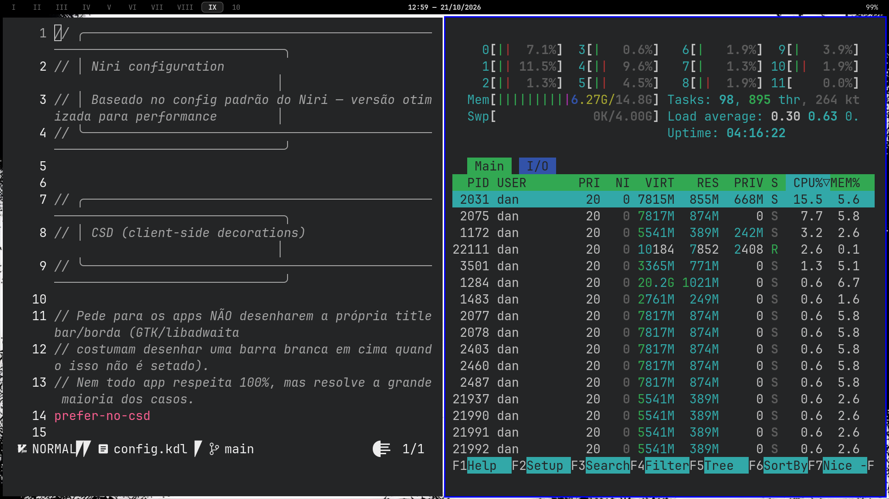

# nirvana

> Arch + niri do Dan, num comando, em qualquer máquina.



Meu ambiente (niri, waybar, alacritty, nvim, rofi…) para instalar em qualquer
máquina. O instalador detecta sozinho **CPU e GPU (AMD, Intel, NVIDIA ou
híbrido)** e a **tela**, e ajusta drivers, refresh e escala.

Feito para: ThinkPad (AMD Renoir, 14" 1080p) e Acer Predator Helios Neo 16
(Intel HX + RTX 4070, 16" 2560x1600 @ 240Hz, MUX).

## Como usar

1. Instale o Arch (`archinstall`) com rede **NetworkManager** e seu usuário
   com sudo. O ideal é o perfil **Minimal**, mas se você já escolheu um
   perfil de desktop (KDE, GNOME…) ou o driver NVIDIA do archinstall, tudo
   bem: o instalador troca os pacotes que conflitam (`power-profiles-daemon`,
   `pulseaudio`, `jack2`, drivers `nvidia*`) e desativa o login gráfico
   antigo (sddm, gdm, lightdm…) para o ly assumir.
2. Copie esta pasta (pendrive, git clone, etc.) e rode:
   ```bash
   ./install.sh
   ```
3. Reinicie e entre no **niri** pelo ly.

## O que o instalador decide pelo hardware

| Detectou | Instala / configura |
|---|---|
| CPU AMD / Intel | `amd-ucode` / `intel-ucode` |
| GPU AMD | `mesa`, `vulkan-radeon` |
| GPU Intel | `mesa`, `vulkan-intel`, `intel-media-driver` |
| GPU NVIDIA | `nvidia-open-dkms` + headers, `egl-wayland`, suspensão NVIDIA, ajuste de VRAM do niri, tira o hook `kms` |
| NVIDIA + Intel/AMD (híbrido) | também `nvidia-prime` (use `prime-run <app>`) |
| Leitor de digital USB | `fprintd` |

### A tela: `niri-hardware`

O `config.kdl` do niri é o mesmo em qualquer máquina; a parte da tela fica
em `~/.config/niri/maquina.kdl`, gerado pelo script `niri-hardware`:

- resolução nativa e **maior refresh** disponível (ex.: 240Hz no Helios)
- **escala pelo tamanho real da tela** (lido do EDID): ThinkPad 1.25, Helios 1.5
- VRR só em jogos (Steam/gamescope)
- com NVIDIA + MUX, cobre eDP-1 e eDP-2 (o nome muda ao trocar o modo)

Trocou de máquina, de tela ou de modo da MUX? Rode `niri-hardware` (o niri
recarrega sozinho). Outros comandos: `niri-hardware gpus`, `niri-hardware cpu`.

## Estrutura

| Pasta | Conteúdo |
|---|---|
| `home/` | niri, waybar, alacritty, nvim, pcmanfm, htop, gtk, `.bashrc`, `niri-hardware`, wallpaper |
| `pacotes/` | `base.txt` (comum), `gpu-amd/intel/nvidia.txt`, `aur.txt`, `flatpak.txt` |
| `sistema/` | zram, NetworkManager+iwd, ly e `nvidia/` (só usado se tiver NVIDIA) |

Não vêm: Downloads, Pictures, Documents, Projects, perfil do Firefox.

## Se algo não funcionar

- **O instalador parou no meio**: tudo fica salvo em `~/nirvana-install-<data>.log`
  e a mensagem final diz a linha. Pode rodar `./install.sh` de novo: ele
  continua de onde dá, sem estragar o que já fez.

- **Brilho não muda (NVIDIA)**: adicione `acpi_backlight=nvidia_wmi_ec` aos
  parâmetros do kernel (`/boot/loader/entries/*.conf`).
- **Teclado ABNT2**: em `config.kdl` troque `layout "us"` / `variant "intl"`
  por `layout "br"` e apague o `variant`.
- **NVIDIA antiga (anterior à GTX 16xx/RTX 20)**: o `nvidia-open` não
  suporta; troque em `pacotes/gpu-nvidia.txt` pelo driver legado do AUR.
- **Ventoinhas/RGB do Helios**: opcional, `paru -S linuwu-sense-dkms`.
- **Firefox**: para levar favoritos/senhas, copie `~/.mozilla` com o Firefox fechado.
